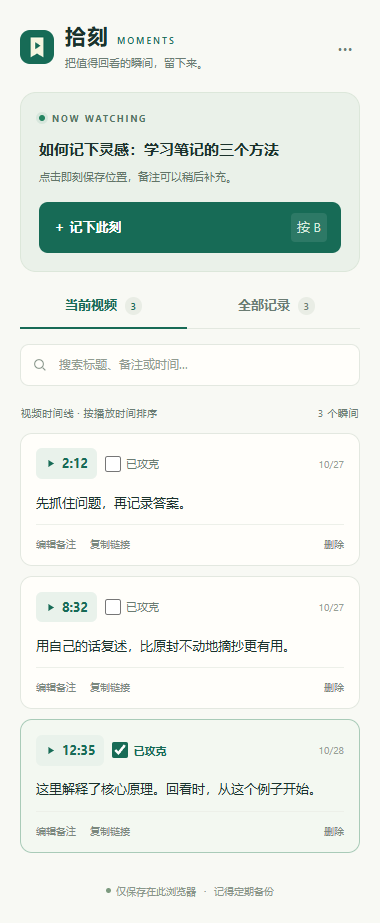

# 拾刻 · YouTube 时间戳

一款无需账号、无需服务器的 Chrome / Edge 扩展。观看视频时记录当前秒数，补充备注，之后点击时间戳即可回看。

## 安装（约 1 分钟）

1. 点击本仓库的 Code → Download ZIP，解压到一个准备长期保留的位置。选中的扩展文件夹应直接包含 manifest.json。
2. Chrome：在地址栏输入 chrome://extensions；Edge：输入 edge://extensions。
3. 打开「开发者模式」。
4. 点击「加载已解压的扩展程序」，选择解压后包含 manifest.json 的文件夹（通常名为 youtube-moments-main）。
5. 在浏览器扩展菜单中，将「拾刻」固定到工具栏。
6. **刷新已经打开的 YouTube 页面。**

不需要执行 npm install，也不需要构建。Chrome 需要 116 或更新版本；Edge 需要支持 sidePanel API 的近期桌面版本。使用企业管理的浏览器时，能否加载本地扩展由管理员策略决定。

## 使用

- 打开 www.youtube.com 上的普通视频观看页。
- 点击页面右下角的「＋ 记下此刻」，或者直接按 **B**（默认单键）。
- 时间戳立即保存；可在出现的小卡片中填写备注并点击「保存备注」。
- 点击浏览器工具栏的拾刻图标，或页面按钮旁的菜单图标，打开侧边栏。
- 侧边栏中的「记下此刻」同样能记录，并弹出可选备注编辑框。关闭编辑框不会删除已经保存的时间戳。
- 「当前视频」按播放时间排列；「全部记录」按视频分组，最近有记录的视频排在前面。
- 点击绿色时间按钮：正在观看同一视频时直接跳转并尝试播放；否则新建一个带时间参数的视频标签页。
- 精听攻克一段后，勾选时间戳旁的「已攻克」。可随时取消，勾选不会触发视频跳转，状态会自动保存；旧记录默认未勾选。
- 浏览器若限制自动播放，定位后手动点击播放器即可。
- 可以搜索标题、备注或 12:35 这样的时间。
- 删除后可在 10 秒内点击「撤销」。

### 自己设置单键

打开侧边栏右上角「···」→「按一个键，记下此刻」→ 选择 A–Z 中的一个字母 →「保存设置」。默认是 B，保存后立即对已经打开的 YouTube 页面生效。

单键只在 YouTube 视频网页获得键盘焦点时工作。在地址栏或侧边栏中时，先点击视频页面的空白处。输入搜索、评论、备注或使用输入法组词时不会触发；长按不会连续记录。建议使用 B，选择 K、J、L、M、F 等键会占用 YouTube 的常用操作。可取消勾选「启用页面单键记录」并保存来关闭。

备用组合键仍为 Alt + Shift + S，可通过「设置备用组合快捷键」打开浏览器设置修改。Chrome 原生扩展命令要求 Ctrl / Alt 等修饰键，单字母由拾刻的页面功能实现。快捷键设置保存在当前浏览器，不包含在记录的 JSON 备份中。

## 备份和迁移

点击侧边栏右上角「···」：

- **备份 JSON**：导出全部记录及攻克状态，可用于恢复或迁移。
- **导入 JSON 备份**：合并记录，跳过重复内容；不会覆盖已有备注或攻克状态。相同记录 ID 的冲突版本会分别保留。旧版备份缺少攻克状态时按未攻克导入。
- **导出 Markdown**：生成按视频分组的笔记，每个时间戳都是可点击的视频链接，并以任务复选框保留攻克状态。

导入会先校验整个文件；有损坏记录时不写入。单个备份文件上限为 8 MB，最多 10,000 条记录，单条备注最多 5,000 字。接近存储上限时会提示先备份和清理。

## 数据与隐私

记录保存在当前浏览器配置文件的 chrome.storage.local 中，不上传到服务器，不调用 YouTube Data API，不收集统计数据。

权限只有：

- storage：保存记录。
- sidePanel：显示浏览器侧边栏。
- https://www.youtube.com/*：读取当前视频的标题和播放位置、显示按钮以及执行跳转。

不同浏览器、不同用户配置文件之间不会自动同步。**卸载扩展、清除扩展数据会丢失本地记录，请先导出 JSON。** 更新时保留同一个扩展文件夹，在扩展管理页点击重新加载即可；不要先卸载。移动到新文件夹可能获得不同的扩展 ID，建议先备份。

## 第一版范围

支持桌面版 YouTube 普通点播视频。不支持手机 YouTube App、Shorts、嵌入播放器和正在进行的直播。广告期间会拒绝记录或跳转；YouTube 改动广告标记或页面结构后可能需要适配。

视频被删除、改为私密、受地区限制时，记录仍保留，但能否播放由 YouTube 决定。视频重新剪辑后，原时间戳可能不再对应同一段内容。

## 文件结构

- manifest.json：扩展清单。
- background.js：后台消息路由、串行存储、快捷键和跨视频跳转。
- content.js：页面按钮、播放器读取、广告与直播检查、同视频跳转。
- panel.html / panel.css / panel.js：侧边栏界面。
- core.js：记录校验、搜索分组、备份合并和导出。
- shortcut.js：单键快捷键设置与触发条件。
- icons/：本地图标。
- tests/：自动化测试。

## 开发验证

扩展本身没有运行时依赖。核心测试需要 Node.js：

    npm test

浏览器集成测试需要安装 Playwright 与 Chromium：

    npm install --no-save playwright
    npx playwright install chromium
    node tests/browser.cjs

也可通过 BROWSER_EXECUTABLE 环境变量指定本机 Chrome 可执行文件。测试创建独立浏览器配置文件和本地模拟视频页面，不访问个人浏览器数据，也不连接真实 YouTube 服务。测试产物写入 .test-artifacts/。

集成测试实际加载扩展，并使用真实 HTML 媒体元素读取/调整 currentTime。真实 YouTube 页面、浏览器侧边栏外框及系统快捷键仍建议安装后进行一次现场验收。已完成的检查详见 [验证说明](docs/TESTING.md)。
